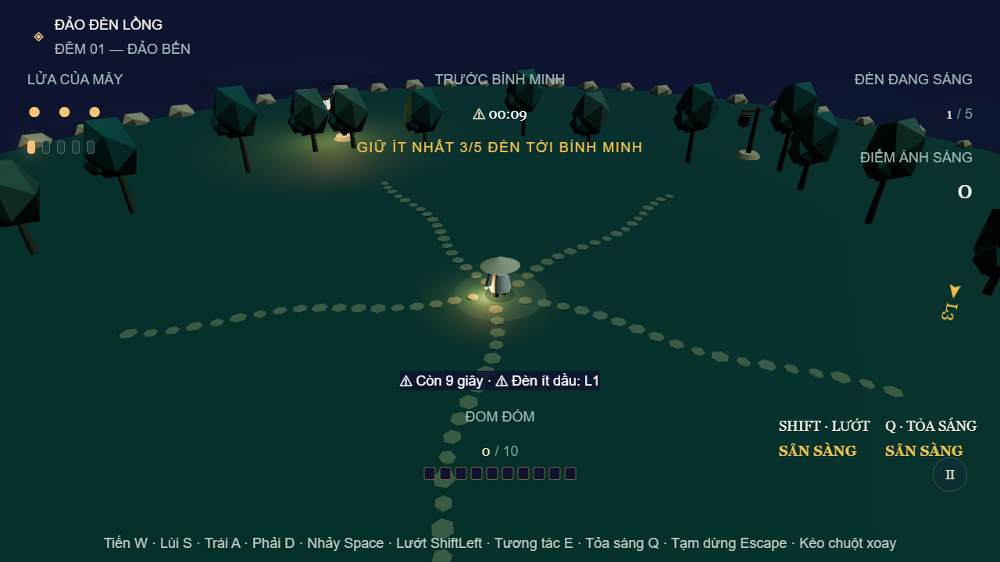

# Đảo Đèn Lồng — Phase 4 · Bình Minh · v1.0.0

Game 3D góc nhìn thứ ba: dẫn Mây qua Đảo Bến, Đảo Cau và Đảo Chuông, thắp 18 ngọn đèn,
tránh Bóng Mực và Gió Lạc. Cảnh/âm thanh procedural; bản web và CLI dùng chung core 60 Hz.

[Báo cáo Phase 3](docs/proof/phase-3/report.md) · [Đặc tả](specs/003-lantern-fuel/spec.md) · [Verify](docs/VERIFICATION.md) · [Breaking changes](CHANGELOG.md)

## Phase 4 · v1.0.0



[Release v1.0.0](https://github.com/nbquang04/K5-L3A-DAY12-NguyenBaQuang-2A202603555-AI-SDLC-Dao-Den-Long/releases/tag/v1.0.0) · [Báo cáo](docs/proof/phase-4/report.md) · [Retro](docs/RETROSPECTIVE.md)

Yêu cầu: Node22+, browser desktop WebGL2, bàn phím/chuột; khuyến nghị1280×720.
Ba lệnh cài/chạy bên dưới vẫn giữ nguyên. ZIP Release đã chứa thư mục web và server,
giải nén rồi `node scripts/serve.mjs`, không cần npm install. Static server khác chạy
được game nhưng cần Node server đi kèm để lưu/xuất leaderboard trên đĩa.

```sh
npm run bench -- --seed 42 --duration 30 --out bench.json
npm run soak -- --seed 7 --nights 10 --out soak.json
npm start -- --export-leaderboard out.json
node scripts/browser-check-phase4.mjs
python scripts/verify.py --config verification/checks.json
```

Benchmark mở Chrome/Edge cài sẵn trong cửa sổ thật, viewport1280×720. Nếu chưa có,
`npx playwright install chromium`; có thể đặt BROWSER_EXECUTABLE_PATH. Linux cần
GUI/display để đo. Cảnh chuẩn200 Bóng Mực,100 đom đóm,3 đèn100dầu, camera30m/15m/15giây,
3giây khởi động rồi30giây đo. Browser rAF chịu vsync; không thể bảo đảm tắt ở driver
nên vsync_off=false. Web không đọc được RSS riêng renderer nên peak_mem_mb=null,
không thay bằng JS heap. p95 dùng nearest-rank ceil(0.95N); 1% low lấy ceil(0.01N)
mẫu chậm nhất. Raw dt trong bench.json.frames.json. Ngưỡng chấm chỉ xác nhận trên
cấu hình giảng viên công bố.

Soak dùng Node `--jitless --max-semi-space-size=1 --expose-gc`: giảm biến thiên JIT/heap
tạm, không đổi luật. GC cùng ranh giới sau load và sau reset mỗi đêm; RSS thật, không
chèn dữ liệu nâng baseline. Input RNG độc lập core, seed7+i, xoay đêm1/2/3. Output chính
đúng schema; sidecar `.details.json` ghi seed/tick/lý do/flags. Các lần thử cờ mặc định
vượt20% được ghi trong báo cáo, không dùng làm kết quả đạt.

Settings đổi đủ9 hành động, phát hiện trùng và khôi phục mặc định; phím phụ cũ chỉ hoạt
động khi không bị hành động khác chiếm. Giảm chuyển động tắt flash/lá bay; không có
camera shake. Chữ tối thiểu18px, chữ lớn×1.25; có caption và spawn arrow ở mép màn hình.
Sau thua hoặc Bình Minh cuối, nhập tên3–12[A-Za-z0-9_] để lưu tổng điểm **các đêm thắng**.
Top10 lưu `.data/leaderboard.json`, giữ khi khởi động lại; không commit dữ liệu người chơi.
LEADERBOARD_PATH chọn file khác cho kiểm thử. API local không có chống gian lận cho
leaderboard thi đấu trực tuyến.


## Chạy game

Yêu cầu Node.js >=22 và npm. Sau clone, từ thư mục repo chạy tối đa ba lệnh:

```sh
npm ci
npm run build
npm start
```

Mở **http://localhost:4173** trong browser desktop có WebGL2. Bản build dist/
không cần mạng/CDN sau cài đặt; có thể phục vụ bằng static server bất kỳ.
Windows đã thử Node 22.17.0; Linux đã thử bằng Docker. Nếu môi trường doanh nghiệp
có CA riêng, dùng cấu hình CA hệ thống phù hợp, không tắt kiểm tra TLS.

## Điều khiển và luật

| Điều khiển | Hành động |
|---|---|
| WASD hoặc mũi tên | Di chuyển theo camera |
| Kéo chuột trên cảnh | Xoay camera |
| Space | Nhảy, cần nhả để nhảy tiếp |
| E | Nạp/châm dầu đèn gần trong 2 m; lần đầu cần 10, thắp lại cần 5 |
| Q | Tỏa sáng, tốn 3 đom đóm, cooldown 3 giây |
| Shift | Lướt 14 m/s trong 0,2 giây, hồi 1,5 giây |
| Esc/P hoặc nút Ⅱ | Tạm dừng/tiếp tục; chơi lại/cài đặt/về menu |

Mây có 3 lửa, túi ban đầu 10; mỗi lần thắp thành công tăng 2, tối đa 20. Chạy 6 m/s; ba Đêm dài 240/270/300 giây.
Bóng Mực đuổi 4 m/s (Đêm 3: 4,5), hit làm rơi nửa túi và miễn nhiễm 90 tick.
Ra ngoài nền sẽ rơi; dưới Y=-10 mất một lửa và toàn bộ đom đóm, hồi sinh sau 60 tick.
Đèn có 100 dầu, hao 1/giây; E dùng mỗi đom đóm châm 10 dầu. Đèn có ít nhất 30 dầu tạo vùng an toàn 6 m.
Đèn yếu có thể bị Bóng Mực hút thêm 5 dầu/giây mỗi con. Hết dầu sẽ tắt; thắp lại cần 5 đom đóm.
Pulse bán kính 3D 5 m, choáng 120 tick, đẩy 4 m trong 15 tick.
Nhặt trong XZ ≤1 m và chênh cao ≤1,5 m. Đảo Cau có cầu/bục nhảy; Đảo Chuông có tầng/dốc/gió.
Bùa Gió tăng chạy lên 7,2 m/s và bỏ hồi lướt trong 10 giây. Gió Lạc cướp tối đa 3 đom đóm;
pulse khi nó mang đồ để thu hồi. Cài đặt âm lượng/độ nhạy chuột được lưu trên trình duyệt.

Giữ ít nhất 3/5, 4/6, 5/7 đèn sáng ở bình minh để thắng từng Đêm; không còn thắng sớm.
Hết lửa luôn thua trước. Tab ẩn tự pause. Cài đặt có “Bảng màu dễ phân biệt”, được lưu sau reload.
Headless hỗ trợ pause: tick vẫn tăng, sim_tick/thời gian/tất cả timer đứng yên.

### Điểm

+5 mỗi đom đóm nạp/châm dầu; +100 lần đầu thắp, +40 thắp lại; pulse +5/con hoặc +15/con đang hút dầu.
Khi thắng: mỗi đèn đang sáng +50 + floor(dầu), mỗi lửa +50; bỏ thưởng thời gian. Scenario không cộng điểm.
Nguồn cấu hình duy nhất: [game.contract.json](game.contract.json).

## Test và headless

```sh
npm test
npm run verify
node src/headless/cli.mjs --seed 42 --night 1 --ticks 600 --out artifacts/run.jsonl
node src/headless/cli.mjs --seed 42 --night 2 --scenario tests/scenarios/phase2/pad.json --ticks 90 --snapshot-every 1 --out artifacts/pad.jsonl
```

CLI ghi JSONL vào --out, snapshot mặc định mỗi 10 tick từ tick 0; input tick k tạo
state/event k+1. Thành công exit 0; inputs/scenario sai định dạng exit 2 và stderr.
Tất cả cờ/schema: [headless contract 1.2](specs/003-lantern-fuel/contracts/headless.md). --night nhận 1, 2, 3.

`npm run verify` assert 12 scenario mới và 10 scenario hồi quy, chạy hai
CLI so từng byte và đo 21.600 tick. Browser được kiểm tra riêng, gồm parity core/CLI.

Toàn bộ Verify tự động, cần thêm Python >=3.10 và Docker Linux:

```sh
python scripts/verify.py --config verification/checks.json
```

Runner trả nonzero nếu test/build/scenario/Linux thất bại. Report có raw log và
trạng thái; không thay thế việc review ảnh/camera/HUD. Xem [ma trận](specs/003-lantern-fuel/verification.md).

## Docker Linux

```sh
docker build -t dao-den-long:phase-3 .
docker run --rm -p 4173:4173 dao-den-long:phase-3
```

CLI: `docker run --rm -v "${PWD}/artifacts:/out" dao-den-long:phase-3 node src/headless/cli.mjs --seed 42 --night 2 --ticks 600 --out /out/run.jsonl`.
Tạo thư mục artifacts trước khi bind mount nếu Docker yêu cầu. Base image pin digest trong Dockerfile.

## Sáng tạo của tôi

Đường đá và đom đóm dẫn ra năm hướng, đảo nổi giữa mây, ánh đèn ấm dần và lời kể
ngắn cho Mây. Tất cả mesh tự sinh; trang trí không dùng RNG gameplay và không thêm
thực thể vào output headless. [Ảnh bắt đầu](docs/proof/phase-1/intro.png) và
[ảnh thắng](docs/proof/phase-1/won.png); replay/core tests chứng minh luật vẫn đúng.

## Tài liệu và giới hạn

[AGENTS](AGENTS.md), [ARCHITECTURE](ARCHITECTURE.md), [constitution](.specify/memory/constitution.md),
[Spec Kit](docs/SPECKIT.md), [STATUS](docs/STATUS.md), [CREDITS](CREDITS.md), [LICENSE](LICENSE).
Phase 2 có âm thanh và lưu cài đặt; chưa lưu tiến độ chiến dịch hoặc hỗ trợ touch/mobile.
Video demo và Release v1.0.0 thuộc bàn giao cuối Phase 4.
Số liệu/bản đồ theo Ticket-02; các điểm chưa đặc tả được ghi rõ trong spec/assumptions.

<details>
<summary>Hướng dẫn lab gốc (giữ để tham khảo)</summary>

# Day 12 — AI SDLC: Đảo Đèn Lồng

> **Cá nhân** (1 người / 1 MSSV) · Áp dụng SDLC cùng AI để xây một **game 3D** qua **4 phase**, từ yêu cầu ban đầu tới bản phát hành.
> **Lab board + trợ giảng:** **[Đảo Đèn Lồng Lab](https://claude.ai/artifact/Q1RYyv1dxjUczzCbd2ZnoW)**

---

## Tài liệu của lab

| File | Nội dung |
|---|---|
| [GUIDE.md](GUIDE.md) | Hướng dẫn làm lab: vòng làm việc mỗi phase, harness, kiểm chứng, token |
| [CHECKPOINTS.md](CHECKPOINTS.md) | Các mốc tự kiểm tra từ chuẩn bị đến nộp bài |
| [SUBMISSION.md](SUBMISSION.md) | Đặt tên repo, hạn nộp, tag, Release, video, checklist |
| [RULES.md](RULES.md) | Quy định: AI, trung thực về bằng chứng, bản quyền, bảo mật |
| [RUBRIC.md](RUBRIC.md) | Thang điểm chi tiết |

## Lab board

Yêu cầu dự án được phát hành tại **[Đảo Đèn Lồng Lab](https://claude.ai/artifact/Q1RYyv1dxjUczzCbd2ZnoW)**. Mỗi phase là một tab (tab chưa phát hành bị khóa), mỗi tab có trợ giảng AI riêng chỉ trả lời trong phạm vi phase đó. Trợ giảng cần đăng nhập claude.ai và dùng lượt Claude của bạn.

## Dự án

**Đảo Đèn Lồng**: game 3D góc nhìn thứ ba. Mây, người giữ đèn nhỏ tuổi, gom đom đóm để thắp lại các Đèn Lồng Lớn và né Bóng Mực trong sương đen.

- Không ràng buộc công nghệ; chạy được trên macOS hoặc Linux.
- Tuân theo **Test Contract** (chế độ headless) để được chấm tự động và so sánh với nhau.

| Phase | Bạn nhận | Nộp |
|---|---|---|
| 1 | **PRD-0** (mô tả tổng quát) + Test Contract | tag `phase-1` |
| 2 | **Ticket-02**, phát hành khi Phase 1 kết thúc | tag `phase-2` |
| 3 | **Ticket-03**, phát hành khi Phase 2 kết thúc | tag `phase-3` |
| 4 | **Ticket-04**, phát hành khi Phase 3 kết thúc | tag `phase-4` + Release `v1.0.0` |

Yêu cầu sẽ được bổ sung và có thể thay đổi giữa các phase, giống dự án thật.

### Lịch 4 giờ

Bài lab kéo dài **4 giờ**. Phase 1 và 2 khoảng **1 giờ**, Phase 3 khoảng **30 phút**, Phase 4 khoảng **1 giờ 30 phút**. Mỗi phase phát hành đúng mốc giờ. Phase mới xuất hiện trên lab board khi tới mốc.

| Mốc | Sự kiện | Hạn tag |
|---|---|---|
| 0h | Phát hành **Phase 1** (PRD-0), gồm cả phần chuẩn bị | `phase-1` trước mốc 1h |
| 1h | Phát hành **Phase 2** | `phase-2` trước mốc 2h |
| 2h | Phát hành **Phase 3** | `phase-3` trước mốc 2h30 |
| 2h30 | Phát hành **Phase 4** | `phase-4`, Release `v1.0.0` và video trước mốc 4h |
| 4h | Hết giờ lab, chốt bài | |

Hết giờ mỗi phase thì tag và chuyển sang phase tiếp theo, dù phase chưa hoàn hảo. Chỗ chưa xong ghi trung thực trong bằng chứng.

---

## Gợi ý SDLC (cách làm là của bạn)

Mỗi phase là một vòng nhỏ. Công cụ, thứ tự, định dạng tài liệu đều tự do; đây chỉ là gợi ý:

1. **Requirements:** biến yêu cầu thành tiêu chí nghiệm thu kiểm chứng được. Chỗ mơ hồ thì tự giả định và ghi lại.
2. **Plan:** nghĩ cách kiểm chứng **trước** khi để agent viết code.
3. **Build:** để agent viết, bạn điều phối và review.
4. **Verify:** chạy thật, kiểm tra hành vi thật. *Không có bằng chứng thì chưa xong*: "agent bảo chạy rồi" không phải bằng chứng.
5. **Evaluate:** cái gì đạt, AI sai ở đâu, harness (AGENTS.md, skill, hook) cần chỉnh gì.
6. **Release:** gắn tag.

## Ba điều cần nhớ

> Bạn được **tự do sáng tạo thêm** quanh phần lõi (nhân vật, cơ chế nhỏ, câu chuyện, hiệu ứng, âm thanh…). Sáng tạo gọn và không phá yêu cầu được tính điểm trong hạng mục F của [RUBRIC](RUBRIC.md); ghi mục "Sáng tạo của tôi" trong README của bạn.

- **Game tốt là game đúng yêu cầu của khách hàng**, không phải game phức tạp hay đẹp nhất. Làm đúng và chứng minh được là đúng trước, trau chuốt sau.
- **Cân nhắc kỹ quota token của bạn.** Đốt nhiều token không làm bài tốt hơn. Ngữ cảnh gọn, kế hoạch rõ, kiểm chứng sớm thường vừa rẻ vừa đúng hơn chạy agent liên tục.
- **Kiểm chứng là phần quan trọng nhất.** Bằng chứng (test, output headless, ảnh, số đo) đáng giá hơn lời mô tả.

---

## Bàn giao cuối cùng

Một **repo GitHub cá nhân, public**, gồm:

1. **Toàn bộ mã nguồn** của game qua 4 phase, tag `phase-1` … `phase-4`, Release `v1.0.0`.
2. **Video demo `.mp4` dưới 5 phút** (đính kèm Release `v1.0.0` hoặc `docs/demo/demo.mp4`, link ở đầu README): chơi thử và cho thấy bằng chứng game chạy đúng.
3. **Bằng chứng kiểm chứng** của từng phase (định dạng tự chọn).
4. **Harness AI đã dùng** (AGENTS.md / CLAUDE.md, skills, hooks, plugins…), giữ nguyên trong repo và lịch sử git.
5. **Ghi chép ngắn:** spec/giả định mỗi phase, nhật ký dùng AI (gồm token/chi phí ước tính), retro.

Không commit API key, token hay `.env`. Gửi link repo theo hướng dẫn của Coach.

## Đánh giá (100 điểm)

| Hạng mục | Điểm |
|---|---|
| Test tự động ẩn (headless, gồm kiểm tra lại phase trước) | 30 |
| Kiểm chứng & bằng chứng của bạn | 20 |
| Quy trình SDLC & harness AI | 15 |
| Evaluation & retro (gồm cách bạn dùng token) | 10 |
| Hiệu năng & ổn định | 10 |
| Chất lượng sản phẩm (đúng yêu cầu, chơi được) | 10 |
| Video demo | 5 |

## Quy định

- Dùng AI thoải mái; không sao chép repo của người khác.
- Bằng chứng phải thật: test luôn đạt hay output sửa tay là vi phạm.
- Nhân vật, bối cảnh là bản gốc của lab; asset bên ngoài chỉ dùng loại CC0/CC-BY/MIT hoặc tự tạo, ghi nguồn trong `CREDITS.md`.

</details>
